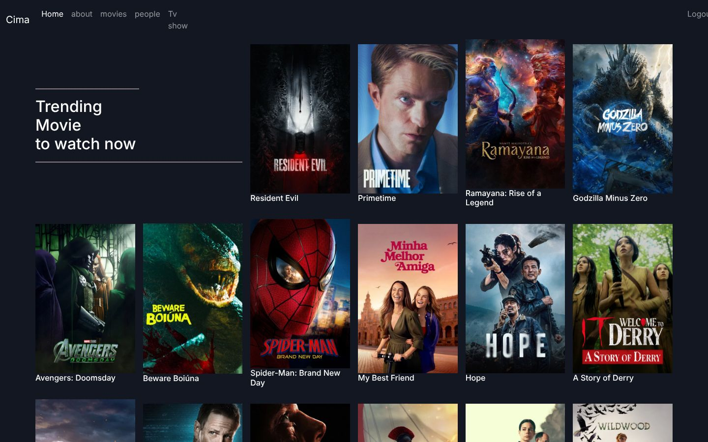
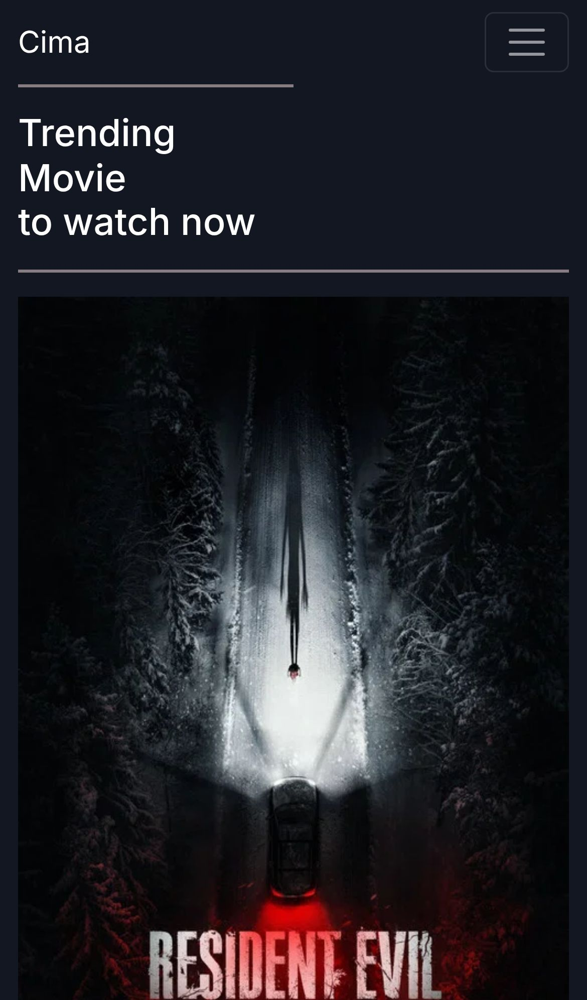
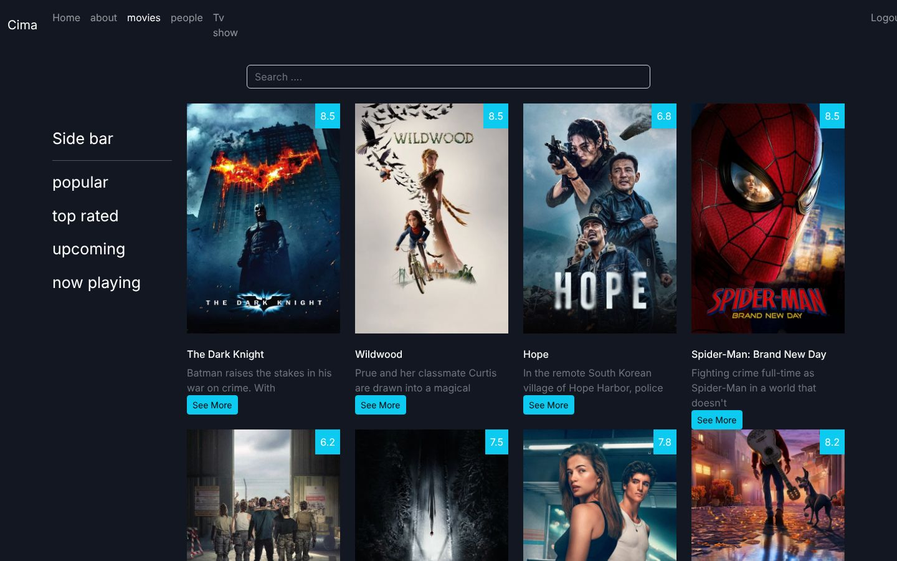
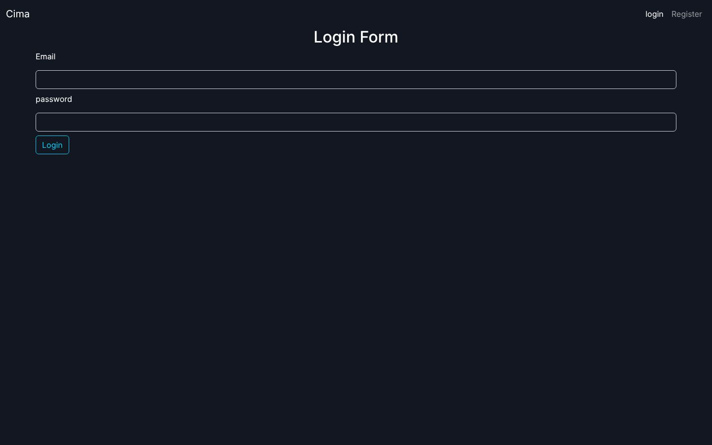

<div align="center">

# Cima

### A movie and TV browsing UI built with React 18 and the TMDB API

A practice clone of a movie-streaming website's browsing experience, from my 2022 front-end training. It shows trending and popular movies, TV shows and people from [The Movie Database (TMDB)](https://www.themoviedb.org/), with search, category filters, pagination, detail pages and JWT-based login and register forms.

[](https://react.dev)
[](https://reactrouter.com)
[](https://create-react-app.dev)
[](https://getbootstrap.com)
[](https://axios-http.com)
[](https://developer.themoviedb.org)
<br>
[](https://eslamraafat1.github.io/Cima/)

**[Live demo](https://eslamraafat1.github.io/Cima/)** ·
**[Portfolio](https://new-portfolio-ashy-xi.vercel.app/)** ·
**[LinkedIn](https://www.linkedin.com/in/eslamraafat-dev/)** ·
**[Email](mailto:eslamraafat736@gmail.com)**

<br>



</div>

<table>
  <tr>
    <td width="33%"></td>
    <td width="67%">
      <br><br>
      
    </td>
  </tr>
  <tr>
    <td align="center"><sub>Mobile (iPhone 13)</sub></td>
    <td align="center"><sub>Movies page with search and filters · Login page (what signed-out visitors see)</sub></td>
  </tr>
</table>

---

## Overview

A **UI clone built for practice**, made during my 2022 React training. It recreates the browsing side of an Arabic movie-streaming site: there is no video playback, and it is **not affiliated with any streaming service**. All titles, posters and ratings come live from the TMDB API.

What I practised:

- Components, `useState` and `useEffect` in React 18
- Client-side routing with React Router 6 (`createHashRouter`, nested routes with `<Outlet />`, URL params with `useParams`)
- Protected routes that redirect to `/login` when there is no token
- Fetching data with Axios, and validating forms with Joi
- Decoding a JWT on the client with `jwt-decode`

> [!IMPORTANT]
> **Live demo status.** Every page except Login and Register is behind a login. The sign-in/sign-up API the app was built against (a course practice backend) is no longer online, so you can't sign in on the live demo today. The home, movies and mobile screenshots above were taken by putting a test token in `localStorage` locally; the TMDB data in them is real and live.

## Features

**Browsing (TMDB API)**

- **Home:** trending movies, TV shows and people of the day, each in its own grid.
- **Movies:** a search box that queries TMDB as you type; a sidebar filter for *popular*, *top rated*, *upcoming* and *now playing*; 10-page pagination; a rating badge on every poster and a **See More** toggle for the overview.
- **Movie details** (`/moviedetils/:id`): poster, tagline, genres, vote average and count, budget and overview.
- **TV** and **TV details** (`/tvdetails/:id`): popular shows, plus genres, first air date and overview.
- **People:** popular people with their profile photos.

**Auth and routing**

- **Register:** first name, last name, age, email and password, validated with Joi (length, age 16–80, `.com`/`.net` emails) before posting to the API.
- **Login:** stores the returned JWT in `localStorage`, decodes it with `jwt-decode` and shows the signed-in navbar.
- **Protected routes:** a `ProtectedRouter` wrapper redirects to `/login` when no token exists. **Logout** clears the token.
- Hash routing (`#/movies`), so deep links work on GitHub Pages, plus a catch-all **NotFound** route.

## Tech stack

| Layer | Tools |
| --- | --- |
| UI | React 18.2 (Create React App build) |
| Routing | React Router 6 (`createHashRouter`) |
| Styling | Bootstrap 5.2, custom CSS |
| Data | Axios, TMDB REST API v3 |
| Forms and auth | Joi validation, `jwt-decode`, `localStorage` |
| Hosting | GitHub Pages |

## Project structure

This repository holds the **production build** that GitHub Pages serves. The React source isn't committed separately, but the source maps in `static/js/*.map` include it (`App.js` and `Component/*`).

```text
.
├── index.html                 # CRA entry (loads static/js/main.*.js)
├── static/
│   ├── js/                    # bundled app + source maps
│   └── css/                   # bundled styles
├── manifest.json · robots.txt · favicon.ico · logo192.png · logo512.png
└── docs/screenshots/          # README images
```

Components in the source map: `Home`, `Movies`, `MovieDetiles`, `Tv`, `TvDetails`, `People`, `About`, `Login`, `Register`, `Navbar`, `MasterLayout`, `NotFound`.

## Getting started

The build is static, so any static server will run it:

```bash
git clone https://github.com/Eslamraafat1/Cima.git
cd Cima
npx serve .          # http://localhost:3000/#/login
```

## Deployment

Hosted on **GitHub Pages** from the `master` branch: **https://eslamraafat1.github.io/Cima/**

## Author

**Eslam Raafat**, Front-End Developer (React · Next.js · TypeScript)

- **Portfolio:** [new-portfolio-ashy-xi.vercel.app](https://new-portfolio-ashy-xi.vercel.app/)
- **LinkedIn:** [linkedin.com/in/eslamraafat-dev](https://www.linkedin.com/in/eslamraafat-dev/)
- **GitHub:** [@Eslamraafat1](https://github.com/Eslamraafat1)
- **Email:** [eslamraafat736@gmail.com](mailto:eslamraafat736@gmail.com)
